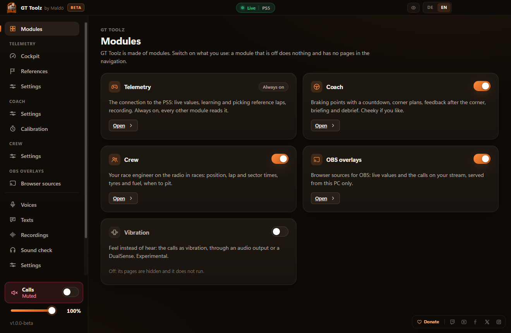
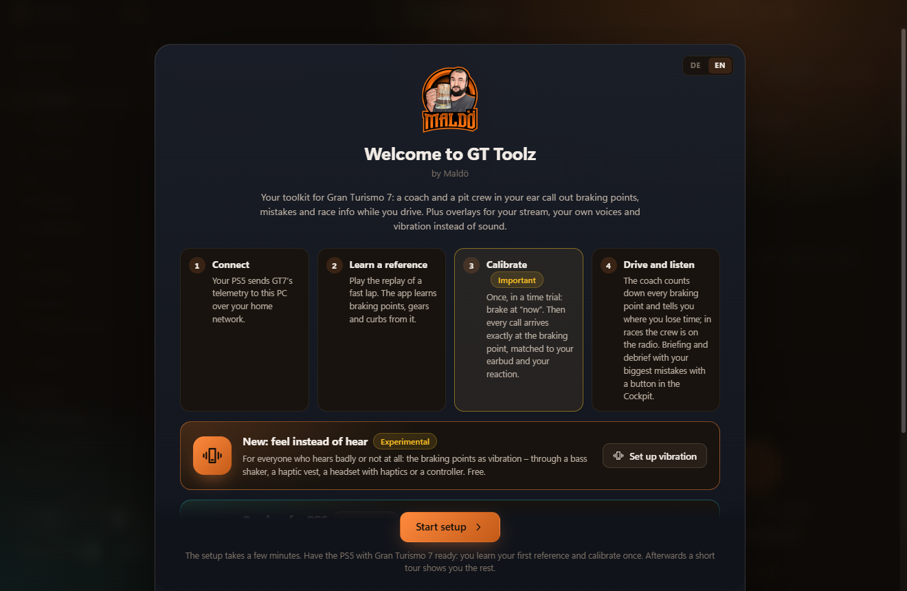
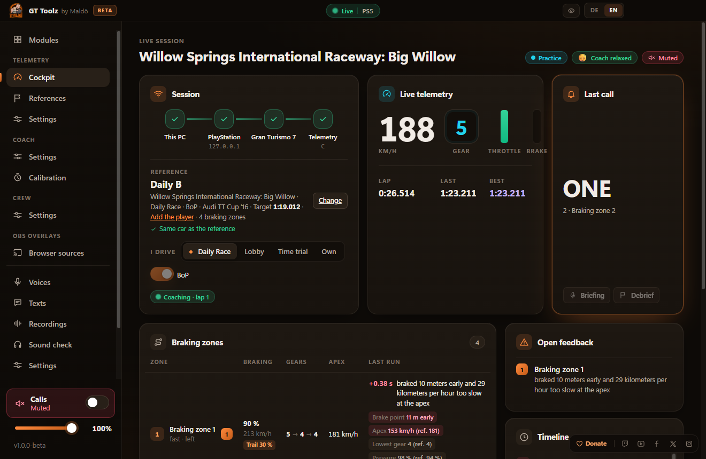
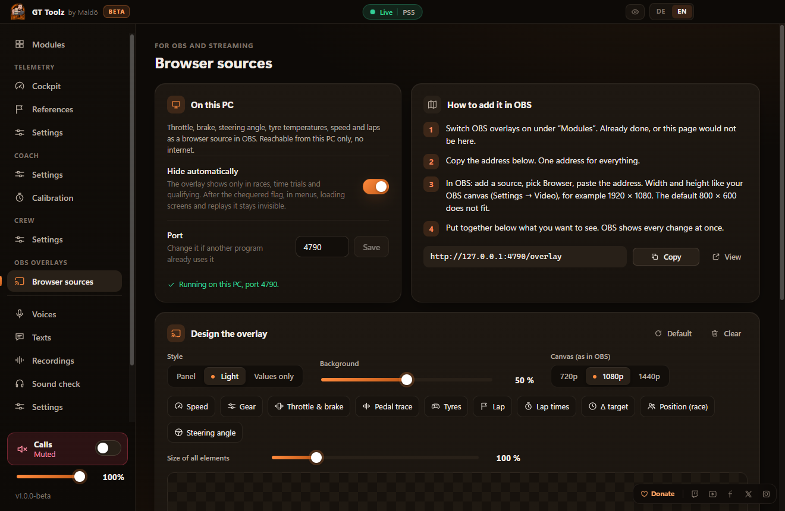
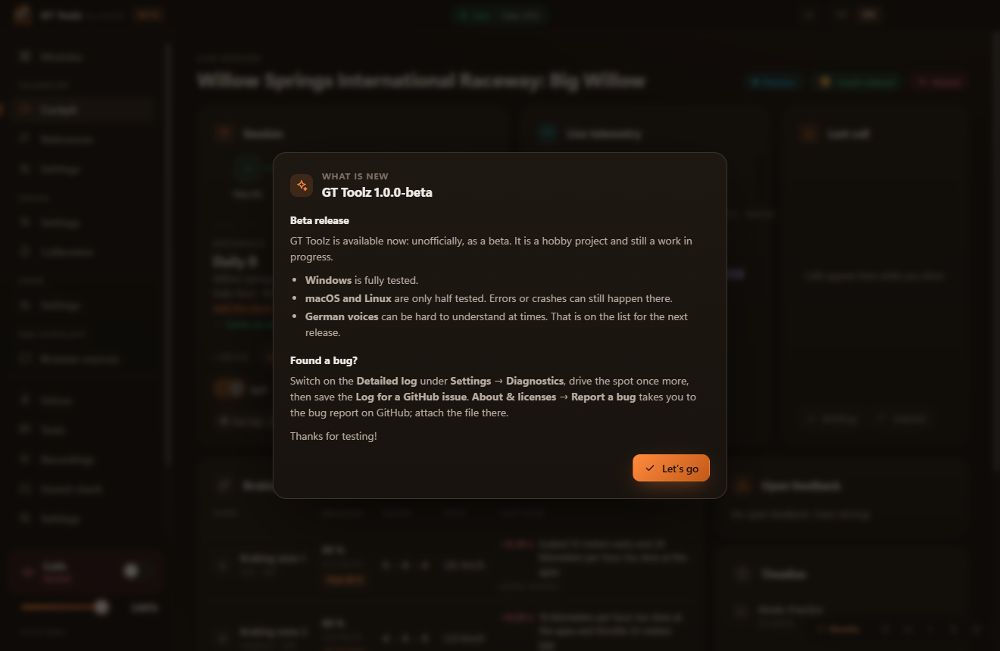
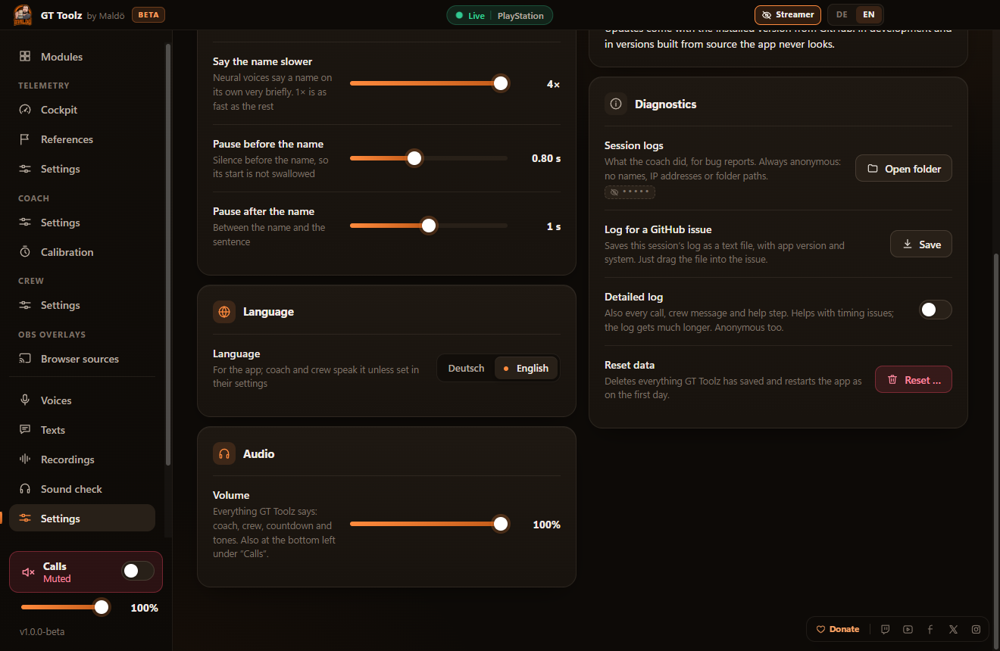

<p align="center">
  
</p>

<h1 align="center">GT Toolz by Maldö</h1>

<p align="center">
  <b>A coach and a race crew in your ear, and overlays for your stream: a free toolkit for Gran Turismo 7.</b>
</p>

<p align="center">
  <a href="https://github.com/nfMalde/gt-toolz/actions/workflows/build.yml"></a>
  <a href="https://github.com/nfMalde/gt-toolz/actions/workflows/pr.yml"></a>
  <a href="https://github.com/nfMalde/gt-toolz/releases"></a>
  <a href="https://github.com/nfMalde/gt-toolz/releases"></a>
  
  
  <a href="LICENSE"></a>
  <a href="https://www.paypal.com/donate/?hosted_button_id=SVZHLRTQ6H4VL"></a>
  <a href="https://www.twitch.tv/maldoe"></a>
</p>

<p align="center">
  <a href="https://github.com/nfMalde/gt-toolz/releases"></a>
</p>

GT Toolz reads the official telemetry that Gran Turismo 7 sends on your home network. A **coach** counts you into
every braking point and tells you what cost time, a **race crew** talks to you on the radio in races, and **overlays**
show your throttle, brake, gear and tyres in OBS. Coach and crew have **a personality of their own**: make the same
mistake once too often and they get cheeky, lose their patience and, in the end, quit on you. They can even speak with
**your own voice**. Everything runs on your own computer: no account, no cloud, no ads.

> [!IMPORTANT]
> **GT Toolz is a hobby project, and this is a beta.** It still has bugs. Windows is fully tested; on **macOS and
> Linux** it is only partly tested, and errors or crashes can happen there. Some German voices can be hard to
> understand at times. Your feedback helps a lot: [report a bug or an idea](https://github.com/nfMalde/gt-toolz/issues/new/choose).

## Contents

- [What it does](#what-it-does) · [Coach and crew with moods](#coach-and-crew-with-moods) · [Your own voice](#your-own-voice) · [What GT Toolz is not](#what-gt-toolz-is-not)
- **For users:** [Installing](#installing) · [First start](#first-start) · [Examples](#examples) · [Updates](#updates) · [Reporting a bug](#reporting-a-bug) · [User guide](docs/user/README.md)
- **For contributors:** [Contributing](#contributing) · [Writing a module](#writing-a-module) · [Build from source](#build-from-source) · [Developer docs](docs/dev/README.md)
- [Privacy](#privacy) · [License](#license) · [No warranty, no liability](#no-warranty-no-liability) · [Links and support](#links-and-support)

## What it does

| Module | What you get |
|---|---|
| **Telemetry** | Finds your PS5, reads GT7's telemetry, recognises the track and the car, learns **reference laps** from your own driving or from a GT7 replay, and picks the right one by itself. |
| **Coach** | Braking points as a countdown ("Full braking ahead … two, one, now"), the corner plan with gears and apex speed, fast corners (flat, lift), trail braking, feedback on the corners that cost the most, the cause of a spin, a briefing and a debrief. Neutral or cheeky. |
| **Race crew** | A race engineer on a radio voice in races: positions, lap and sector times, laps to go, fuel and tyre strategy. Quiet in the lobby and in qualifying, and from the chequered flag on. |
| **OBS overlays** | One browser source for OBS, put together by drag and drop: speed, gear, pedals, trace, tyres, laps, delta, position, steering. Runs on your PC only. |
| **Vibration** | The calls as vibration: PS5 controller, bass shaker or haptic vest, for drivers who hear badly or want it quieter. |
| **Voices and texts** | German and English; system voices, neural voices to download, or your own recorded voice. Every spoken text can be reworded. |

Each module can be switched on and off. The [user guide](docs/user/README.md) explains each of them in detail.



## Coach and crew with moods

GT Toolz is not a neutral voice prompt. With the **cheeky** coach style (**Settings → Personality**) coach and crew
have a personality, and they react to how you drive:

- **The coach helps first.** It explains a mistake, gives you a tip and guides you through the corner. If you keep
  making the same mistake anyway, it gets pointed: *"Late again. A braking point is not a braking suggestion."* Then it
  gets loud: *"Unbelievable! Braking zone 2! Again! I quit!"*
- **When its patience runs out, it really quits:** *"You know what? Do it yourself. I am getting a coffee."* A
  **stand-in** with another voice takes over for a few laps (*"Stand-in here. Your coach is crying in the pit box. We
  just keep driving."*), until it has had enough too and fetches your coach back.
- **The race crew** gets annoyed by every trip into the gravel, from a friendly hint to open sarcasm. Keep going off,
  and the race engineer hands the radio to the **team boss**: *"Right. Handing over to the team boss. He has more
  patience. Or so he says."*
- **The debrief** may add a bonus mistake: *"Mistake number 4: racing today instead of mowing the lawn. The lawn would
  have been happy."*
- **Clean laps calm them down again.** You choose how fast they lose their patience (**A lot**, **Normal**, **Little**),
  or the **Factual** style without remarks. The braking calls themselves always stay factual, so a remark never costs
  you a braking point.

Every line, cheeky or not, can be reworded on the **Texts** page.

## Your own voice

Coach, crew and stand-in can speak with **your own voice**, or with a friend's who agreed to it:

1. Open **Recordings**, create a voice pack and record the texts one by one: Space starts and stops, the arrow keys
   go to the next text. The app trims the silence and levels each take.
2. Start with the short corner calls ("now", the countdown, the gears) and your name; the rest is optional. Sentences
   your pack can say completely come from your recordings, the voice you picked says everything else.
3. Under **Voices**, pick the role and choose your pack in **Own recordings**, and you hear yourself counting down the
   next braking point.

Packs can be **exported** as a `.gttvoice` file and **imported** on another PC, so you can share the coach in your
voice with friends. GT Toolz uploads nothing and hosts nothing: you pass the file on yourself, and only voices whose
speakers agreed. Details: [Your own recorded voice](docs/user/voices.md#your-own-recorded-voice).

## What GT Toolz is not

- **Not an AI, and it will not become one.** Everything coach and crew say comes from fixed rules and from texts
  written by hand, which you can change on the Texts page. Nothing is generated, there is no chatbot, and nothing
  about you is sent anywhere to be analysed. When GT Toolz "learns" a reference, it records a lap and measures where
  the braking points are: measuring, not machine learning. The optional neural voices are trained speech models that
  only read these texts aloud. An AI coach would need servers and money, and GT Toolz stays free and offline.
- **No servers: no leaderboards, no accounts, no cloud.** Online rankings, shared ghost databases, cloud saves or a
  web service would mean hosting costs every month. GT Toolz stays free, so there will be none of that. Everything
  stays on your PC; the only internet connections are the voice downloads you start yourself and the update check
  you agreed to.
- **Not an official product** of Sony Interactive Entertainment or Polyphony Digital (see
  [No warranty, no liability](#no-warranty-no-liability)).

## Installing

Download the installer for your system from the **[releases page](https://github.com/nfMalde/gt-toolz/releases)**.
You need a PS5 with Gran Turismo 7 and a computer in the same home network.
**The PS4 is not supported:** GT Toolz has not been tested with GT7 on a PS4.

> [!TIP]
> **New to GitHub?** You need no account. Open the [releases page](https://github.com/nfMalde/gt-toolz/releases): the
> newest version is at the top. Scroll down to **Assets** below its description and click the file for your system
> from the table below; it downloads like any other file. The files named *Source code* are not needed.

| System | File | Requirements |
|---|---|---|
| **Windows** | `GT-Toolz-Setup-<version>-x64.exe` | Windows 10 or 11, x64 |
| **macOS** | `GT-Toolz-<version>-mac-arm64.dmg` (Apple silicon) or `…-mac-x64.dmg` (Intel) | macOS 13 Ventura or later |
| **Linux** | `gt-toolz_<version>_amd64.deb` | Ubuntu 22.04 or later, Debian 12 or later, x64 |

**Which Mac do you have?** Apple menu → **About This Mac**: "Chip: Apple M…" means `mac-arm64`, "Processor: Intel" means
`mac-x64`. The wrong file breaks nothing: the Apple silicon file does not start on an Intel Mac. The Intel file does run
on Apple silicon through Rosetta 2, but it starts more slowly, needs more computing power and keeps updating as the Intel
version until you install the other file, so take the matching one.

The installers are **not signed** (see [Signing](#signing)), so your system warns once:

- **Windows:** run the installer. SmartScreen says "Windows protected your PC": choose **More info**, then **Run anyway**.
  GT Toolz installs for your user only (no admin rights) and starts. When Windows asks about the firewall, allow
  **private networks** only.
- **macOS:** open the disk image and drag GT Toolz to **Applications**. On the first start macOS says it cannot check
  the app: open **System Settings → Privacy & Security** and click **Open Anyway**. If macOS calls the app "damaged",
  run `xattr -dr com.apple.quarantine "/Applications/GT Toolz.app"` in Terminal once. Allow the local network when
  asked; that is how the app finds the PS5.
- **Linux:** install with `sudo apt install ./gt-toolz_<version>_amd64.deb` (or open the file in your software
  installer), then start GT Toolz from the menu or with `gt-toolz`.

Optional: check the file before installing. Compare its SHA-256 with `SHA256SUMS.txt` from the same release
(`Get-FileHash <file>` on Windows, `shasum -a 256 <file>` on macOS, `sha256sum <file>` on Linux), or verify where it was
built with the [GitHub CLI](https://cli.github.com/): `gh attestation verify <file> --repo nfMalde/gt-toolz`.

Your settings, references and voices stay when you uninstall: in `%APPDATA%\GT Toolz` (Windows),
`~/Library/Application Support/GT Toolz` (macOS) or `~/.config/GT Toolz` (Linux).

## First start

1. **Start GT Toolz.** The welcome window opens; pick **DE** or **EN** at the top and click **Start setup**.
2. **Start GT7 on the PS5** and drive or watch a replay. The setup assistant finds the PS5 as soon as telemetry
   arrives. Nothing needs to be set up in the game.
3. **Pick a voice.** On Windows and macOS the system voice works right away; better offline voices are optional
   downloads. On Linux, download one voice in the assistant.
4. **Calibrate once:** start a time trial, click **Start calibration** and brake exactly at "now" five times.



A wireless earbud on the computer works best: the game sound stays on your TV or headset, the coach talks in your ear.
The full walkthrough is in [Getting started](docs/user/getting-started.md).

## Examples

**Learn a track and get coached**
1. In GT7 open **Sport mode → Daily Race**, start the replay of a fast driver from the leaderboard and let one full lap
   play. GT Toolz learns the braking points from it.
2. Start a time trial on the same track. From the line on you hear: *"Full braking ahead. Hairpin right. In with first
   gear. Two, one, now."*
3. After the lap the coach tells you the corner that cost the most and what to try. No replay at hand? Just drive three
   laps: GT Toolz takes your fastest as the reference.



**Race with your crew**
1. Start any race (offline or in a lobby). In the lobby and in qualifying the crew stays quiet.
2. At the start: *"Radio check. Your crew here."* Then the position when it changes, your lap times, fuel per lap,
   when the tyres go off and when to pit, and the last lap.

**Show your driving on stream**
1. Switch on **OBS overlays** on the **Modules** page, open **Browser sources** and copy the link.
2. In OBS add a **Browser source** with that link, 1920 × 1080. Arrange the elements in the app's editor by drag
   and drop; the overlay hides by itself outside sessions.



More: [coach](docs/user/coach.md) · [race crew](docs/user/crew.md) · [overlays](docs/user/overlays.md) ·
[vibration](docs/user/haptics.md) · [voices](docs/user/voices.md) · [texts](docs/user/texts.md).

## Updates

The installed version from the releases page asks you once (in the news window after the first start) whether it may
look for updates; the box is ticked, and you can untick it. Then it asks GitHub at every start whether there is a newer
version and shows you what changed: **Update** downloads the installer, checks it against the release's checksums and
installs it; **Later** asks again at the next start, and the **Update** button in the title bar starts it any time.
Switch it off under **Settings → Updates**. Versions built from source never look. Details:
[Updates and news](docs/user/updates.md).

After each update a short window shows what is new:



## Reporting a bug

Bugs are reported in the [issues](https://github.com/nfMalde/gt-toolz/issues/new/choose). **Please attach the
detailed log:**

1. In GT Toolz open **Settings → Diagnostics** and switch on **Detailed log**.
2. Make the bug happen again.
3. Click **Log for a GitHub issue** and save the file. It is anonymous, see below.
4. Open a [bug report](https://github.com/nfMalde/gt-toolz/issues/new?template=bug_report.yml) and drag the file into
   the **Log** field.



**The logs are anonymous, always.** Before a line is written to a log, GT Toolz replaces everything that could
identify you or others: your driver name (`<driver>`), other players' names (`<player>`), your console's name
(`<console>`), IP addresses (`<lan-ip>`), e-mail and hardware addresses, the app's folders and the user name in any path
(`<user>`). That holds for the normal and the detailed log, and for the file you attach to an issue. This is a fixed
rule of the project: no change may ever write personal data into a log (see [CONTRIBUTING.md](CONTRIBUTING.md)).

The app also keeps its session logs in the `sessions` folder of its data folder (`%APPDATA%\GT Toolz\sessions`,
`~/Library/Application Support/GT Toolz/sessions`, `~/.config/GT Toolz/sessions`); **Settings → Diagnostics → Open
folder** opens it. More help: [Troubleshooting](docs/user/troubleshooting.md).

Security issues please [privately](https://github.com/nfMalde/gt-toolz/security/advisories/new), see
[SECURITY.md](SECURITY.md).

## Contributing

Fixes, ideas and new modules are welcome. The short version:

1. **Fork** the repository and create a branch from `main` (`fix/…` or `feat/…`).
2. **Set it up** (see [Build from source](#build-from-source)) and run it in development mode: `npm run dev`.
3. **Make the change** in the style of the code around it, with a test in `tests/`. UI texts come in English and
   German.
4. **Check it:** `npm run typecheck`, `npm test` and `npm run build:app` must pass.
5. **Open a pull request** to `main` and describe what and why. The **PR build** runs on Windows, Linux and macOS.
6. **Sign the CLA** once: the bot asks in your first pull request ([CLA.md](CLA.md)).

New dependencies need a short discussion in an issue first: GT Toolz keeps them few and pinned. Everything else is in
[CONTRIBUTING.md](CONTRIBUTING.md) and the [developer docs](docs/dev/README.md): the
[architecture](docs/dev/architecture.md), a [code map](docs/dev/code-map.md), [testing](docs/dev/testing.md)
(also without a PS5, with recordings) and the [security rules](docs/dev/security.md).

## Writing a module

GT Toolz is a shell with modules: telemetry, coach, crew, overlays and vibration are each a module with their own
main-process part, settings and pages. A new module gets the telemetry frames and the session mode from its host,
keeps its own settings, talks to its UI over its own bridge namespace, and shows up on the Modules page to be switched
on or off.

The tutorial [Writing a module](docs/dev/modules.md) builds a complete small module step by step, with every file it
needs: the main part, settings with defaults, the bridge, a UI page with its store, texts in English and German, the
registration in the app and a test.

## Build from source

You need **Node.js 22.23.2** (or a later 22.x, at least 22.22.3), npm and git. Builds from source run the same as the
installers but never look for updates.

```sh
git clone https://github.com/nfMalde/gt-toolz.git
cd gt-toolz
npm ci                                # exact versions from the lockfile; install scripts are off (.npmrc)
node node_modules/electron/install.js # Electron's binary, once (install scripts are off)
npm run dev                           # development mode with reload
```

Other commands: `npm test` (tests), `npm run typecheck`, `npm run build:app` (production build of the UI and the
main process), `npm run app` (build and start it), `npm run release` (installers).

**Installers** are built on the system they are for, with `npm run release` (build, tests, the installer of this
system and its test; the result is in `release/<version>/`):

- **Windows** (PowerShell): `npm ci; node node_modules/electron/install.js; npm run release`
  → `GT-Toolz-Setup-<version>-x64.exe`
- **macOS** (Terminal): `npm ci && node node_modules/electron/install.js && npm run release`
  → `GT-Toolz-<version>-mac-arm64.dmg` and `…-mac-x64.dmg`
- **Linux** (Ubuntu or Debian, also WSL2; `dpkg-deb` comes with the system, and without a display the installer test
  needs `sudo apt install xvfb`): `npm ci && node node_modules/electron/install.js && npm run release`
  → `gt-toolz_<version>_amd64.deb`

Single steps: `npm run release -- --steps=build,test` or `--skip=verify` (without the installer test, which installs and
removes the app). Details: [Building and releasing](docs/dev/building.md).

## Signing

The installers are not code-signed yet. A Windows code-signing certificate and an Apple Developer account cost money
every year, which a free hobby project cannot carry for now; the macOS app has an ad-hoc signature. Windows and macOS
therefore warn once (see [Installing](#installing)). To make up for it, every release has a `SHA256SUMS.txt` and
[build provenance](https://docs.github.com/actions/security-for-github-actions/using-artifact-attestations) for each
installer, so you can check that a file was built by this repository's release workflow. The checksum list itself is
signed with the project's key (`SHA256SUMS.txt.sig`): the app installs an update only when that signature is valid.
Free code signing for open-source projects may follow later.

## Privacy

GT Toolz talks to your PS5 in the home network. The OBS overlay server listens on `127.0.0.1` only, and only while it
is on. The app goes online only for what you agreed to: voice downloads you start yourself, and the update check (asked
once). No analytics, no tracking, no account. Logs are anonymous (see [Reporting a bug](#reporting-a-bug)). Details: [Privacy](docs/user/privacy.md).

## License

GT Toolz is free software: you can redistribute it and/or modify it under the terms of the
**[GNU General Public License v3.0](LICENSE)** as published by the Free Software Foundation.

Copyright (C) 2026 Malte Peters (Maldö)

Contributions are accepted under the [Contributor License Agreement](CLA.md). Third-party components, data and voices
keep their own licenses; they are listed in [THIRD-PARTY-NOTICES.md](THIRD-PARTY-NOTICES.md) and in the app under
**About & licenses → Third-party licenses**.

## No warranty, no liability

GT Toolz is provided **"as is", without warranty of any kind**, express or implied, including the warranties of
merchantability and fitness for a particular purpose (GPL-3.0, sections 15 and 16). To the extent permitted by
applicable law, the authors and contributors are **not liable** for any damage or loss arising from the use of GT
Toolz, including lost races, results or data. You use it at your own risk.

Driving aids in online races or events can be against the rules of a league or an organiser; whether you may use GT
Toolz there is your responsibility.

GT Toolz is an independent tool. It is not affiliated with, endorsed, sponsored or approved by Sony Interactive
Entertainment Inc. or Polyphony Digital Inc. "Gran Turismo", "GT7", "PlayStation" and "PS5" are trademarks or registered
trademarks of Sony Interactive Entertainment Inc. Track, corner and car names are used only for identification and
belong to their owners.

## Links and support

GT Toolz is a project by **Maldö**. It stays free; if you like it, you can support it with a donation (no perks, just
thanks).

- **Donate:** [PayPal](https://www.paypal.com/donate/?hosted_button_id=SVZHLRTQ6H4VL)
- **Maldö:** [Twitch](https://www.twitch.tv/maldoe) · [YouTube](https://www.youtube.com/@dermaldoe) ·
  [X](https://x.com/DerMaldoe) · [Instagram](https://www.instagram.com/maldoe_gaming/) ·
  [Facebook](https://www.facebook.com/RealMaldoe)
- **Project:** [Releases](https://github.com/nfMalde/gt-toolz/releases) · [Issues](https://github.com/nfMalde/gt-toolz/issues) ·
  [Changelog](CHANGELOG.md) · [User guide](docs/user/README.md) · [Developer docs](docs/dev/README.md)
